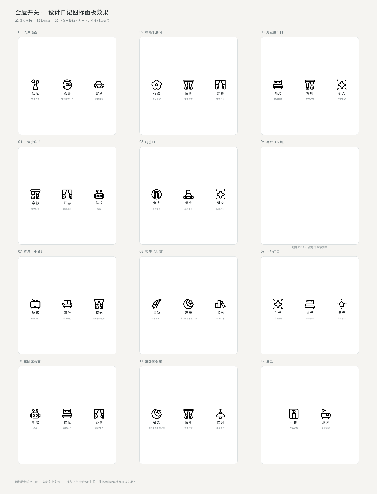

# 全屋灯光

灯光图标、面板名称和按键顺序核对资料，供智能控制方案沟通使用。当前版本 **v1.0.0**。

- [下载当前仓库 ZIP](https://github.com/misslamajay/home-lighting/archive/refs/heads/main.zip)
- [全屋面板高清总览](全屋面板_图标对应效果.png)
- [面板按键对应表 CSV](面板按键对应表.csv)

## 文件

| 文件或目录 | 用途 |
| --- | --- |
| `svg/original/` | 22 款 SVG 图标原稿，按当前名称命名 |
| `svg/icons/` | 去除画板白底并等比适配的预览 SVG |
| `manifest.json` | 图标、名称、面板和按键的结构化对应 |
| `面板按键对应表.csv` | 32 个按键逐项核对 |
| `index.html` | 可放大面板、切换底色和显示灯位小字的预览页 |
| `SHA256SUMS.txt` | 文件校验值 |

## 当前顺序

按键顺序从左到右。主卧门口为 **引光 → 榻光 → 循光**；壁龛灯带名称为 **一隅**。

| 面板 | 位置 | 按键与灯位 |
| --- | --- | --- |
| 01 | 入户墙面 | 初见（玄关灯带） → 流影（玄关过道射灯） → 暂别（离家模式） |
| 02 | 榻榻米房间 | 花语（花朵主灯） → 帘影（窗帘灯带） → 舒卷（窗帘开关） |
| 03 | 儿童房门口 | 榻光（床尾射灯） → 帘影（窗帘灯带） → 引光（过道射灯） |
| 04 | 儿童房床头 | 帘影（窗帘灯带） → 舒卷（窗帘开关） → 总控（总控） |
| 05 | 厨房门口 | 食光（餐厅吊灯） → 烟火（厨房主灯） → 引光（过道射灯） |
| 06 | 客厅（左侧） | 超能 PRO，不刻字 |
| 07 | 客厅（中间） | 映幕（电视射灯） → 闲坐（沙发射灯） → 晴光（南边窗帘灯带） |
| 08 | 客厅（右侧） | 星轨（磁吸轨道灯） → 浮光（客厅悬浮吊顶灯带） → 书影（书柜灯带） |
| 09 | 主卧门口 | 引光（过道射灯） → 榻光（床尾射灯） → 循光（走廊射灯） |
| 10 | 主卧床头右 | 总控（总控） → 榻光（床尾射灯） → 舒卷（窗帘开关） |
| 11 | 主卧床头左 | 栖光（主卧悬浮吊顶灯带） → 帘影（窗帘灯带） → 枕月（床头吊灯） |
| 12 | 主卫 | 一隅（壁龛灯带） → 清沐（卫浴射灯） |

## 预览尺寸

图标最长边 9 mm，名称字身 3 mm、字距 0.25 mm。名字下方的浅灰小字用于核对灯位。玻璃外框和按键间距为示意，实物尺寸与刻印工艺需在打样时复核。

本次同步了新版「映幕」和「闲坐」SVG。「闲坐」与上一版图形一致。

## 本地查看

将资料包解压，在目录运行 `python3 -m http.server 8080`，再打开 `http://127.0.0.1:8080/`。
